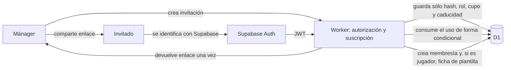
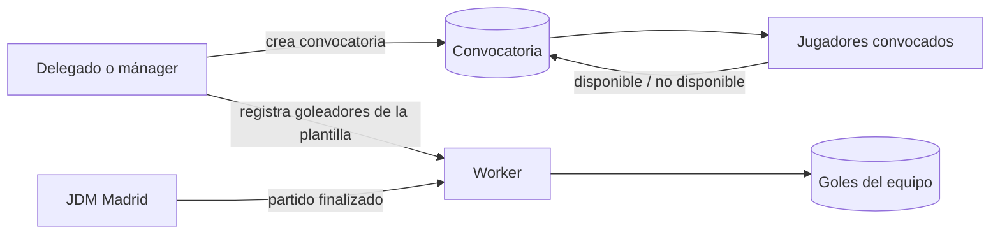

# Decisiones de arquitectura y despliegues externos

Última actualización: 17 de octubre de 2026

Este documento registra decisiones que afectan a la arquitectura, servicios externos y despliegues. Debe actualizarse cuando una decisión cambie o se incorpore una dependencia que no se despliegue junto con la aplicación principal.

## Resumen de componentes

| Componente | Tecnología o proveedor | Despliegue | Estado |
| --- | --- | --- | --- |
| Frontend | React + Vite | Cloudflare Pages | Configurado |
| API y tareas programadas | Cloudflare Worker | Cloudflare | Configurado |
| Datos de producto | Cloudflare D1 | Cloudflare | Existente; migración v2 pendiente |
| Autenticación | Supabase Auth | Proyecto Supabase independiente | Integrada; configuración externa pendiente |
| Fuente de competiciones | API de datos abiertos de Madrid | Servicio externo | Integrada |
| Facturación | Proveedor por decidir | Servicio externo independiente | Pendiente |
| Correo transaccional | Proveedor por decidir | Servicio externo independiente | Pendiente |

## DEC-001 — Conservación de las pantallas existentes

**Estado:** aceptada y no negociable.

La migración a React debe conservar el estilo y las funcionalidades de las pantallas existentes. Los cambios de identidad, organización y equipo se implementarán en capas de contexto, navegación, API y persistencia sin rediseñar el organizador, la pizarra táctica ni la vista de partidos.

Cada pantalla y sus datos deben quedar aislados por equipo mediante `team_id`.

## DEC-002 — Supabase Auth como proveedor de identidad inicial

**Estado:** aceptada provisionalmente.

Se utilizará **Supabase Auth** para registro, inicio de sesión, recuperación de acceso y emisión de sesiones/JWT.

Alcance inicial:

- Supabase se utilizará únicamente como proveedor de autenticación.
- Los workspaces, equipos, roles, plantillas, partidos y seguimientos seguirán perteneciendo al modelo de la aplicación.
- Cloudflare D1 seguirá siendo la base de datos de producto.
- No se migrarán los datos de producto a PostgreSQL/Supabase en esta fase.
- La relación con un usuario autenticado se realizará mediante el identificador estable incluido en el JWT de Supabase.

Motivos:

- Permite comenzar con una capa gratuita.
- Evita desplegar y mantener Keycloak, PostgreSQL y un contenedor de identidad.
- Incluye registro, recuperación de contraseña y proveedores sociales sin construirlos desde cero.
- Mantiene separada la identidad de los datos específicos del producto.

Consecuencias:

- Supabase será una dependencia externa desplegada y administrada por separado.
- La disponibilidad del inicio de sesión dependerá de Supabase.
- Será necesario definir una estrategia de exportación o migración de usuarios antes de abandonar el proveedor.
- Las políticas y límites del plan gratuito deberán revisarse antes de abrir el producto a un volumen significativo.

### Estado técnico

La aplicación usa `@supabase/supabase-js` para registro, acceso, recuperación, renovación y cierre de sesión. El Worker valida firma, emisor, audiencia y caducidad contra el JWKS del proyecto mediante `jose`. El primer acceso sólo registra la identidad: el usuario no recibe equipo ni rol hasta aceptar una invitación o ser asignado explícitamente como mánager. Antes de producción sigue siendo necesaria una prueba de extremo a extremo contra el proyecto Supabase definitivo.

### Configuración externa pendiente en Supabase

- Crear un proyecto separado para producción.
- Configurar la URL pública del sitio.
- Registrar las URLs de redirección de local, preproducción y producción.
- Elegir los métodos de acceso iniciales; por defecto, correo y contraseña.
- Configurar plantillas de correo y remitente antes de producción.
- Registrar de forma segura las variables públicas y secretos necesarios para frontend y Worker.
- Revisar límites, retención de logs y condiciones del plan antes del lanzamiento.

## DEC-003 — Cloudflare continúa alojando la aplicación

**Estado:** aceptada.

La aplicación React, la API, las tareas programadas y D1 continuarán en Cloudflare como dos despliegues:

- React compilado en `public-build/` y publicado en Cloudflare Pages.
- `worker.js` como API privada y adaptador JDM.
- D1 para usuarios internos, workspaces, equipos, membresías y seguimientos.
- Cron de Cloudflare para sincronización periódica con JDM.

Supabase Auth y Cloudflare forman despliegues independientes. Un despliegue de la aplicación no configura automáticamente el proyecto Supabase.

## DEC-004 — Roles, seguimiento y gestión de pago

**Estado:** aceptada; interfaz de gestión implementada y proveedor de pago pendiente.

La gestión interna de un equipo será una funcionalidad de pago. Seguir equipos, calendarios y clasificaciones será una función gratuita.

### Modelo de acceso

| Capacidad | Mánager / presidente | Delegado | Jugador | Aficionado |
| --- | --- | --- | --- | --- |
| Gestionar suscripción | Sí | No | No | No |
| Configurar el equipo y sus miembros | Sí | No | No | No |
| Invitar delegados y jugadores | Sí | No | No | No |
| Gestionar plantilla | Sí | Sí | No | No |
| Crear alineaciones y táctica | Sí | Sí | No | No |
| Crear convocatorias | Sí | Sí | No | No |
| Responder convocatorias | Sí, si figura en plantilla | Sí, si figura en plantilla | Sí | No |
| Registrar goleadores | Sí | Sí | No | No |
| Seguir equipos, calendario y clasificación | Sí | Sí | Sí | Sí |

“Aficionado” no es un rol de `team_members`: es una relación gratuita de seguimiento entre usuario y equipo oficial. Esto evita conceder permisos internos a quien sólo quiere consultar la competición.

La pertenencia administrativa y la ficha de plantilla son conceptos distintos. Un mánager o delegado puede estar también en `roster_players` si juega, sin perder su rol principal.

### Suscripción

- La suscripción pertenece al equipo y tiene un usuario responsable de facturación.
- Los permisos de gestión se comprueban en la API junto con el estado de la suscripción.
- Ocultar botones no sustituye la autorización del servidor.
- Sólo FC OGS, FC OGS II e INTER MACCABI reciben el plan `pilot` activo para no bloquear su gestión antes de integrar pagos.
- Las altas ordinarias nacen con plan `free` inactivo para la gestión interna. No se concede acceso piloto automáticamente a nuevos registros.
- Antes del lanzamiento comercial se deberá elegir el proveedor, definir precios, estados, webhooks, impagos, cancelaciones y transferencia de la responsabilidad de facturación.

### Invitaciones

- Los delegados sólo pueden recibir una invitación individual.
- Una invitación individual tiene un único uso.
- Los jugadores pueden entrar mediante un enlace individual o uno colectivo con cupo configurable.
- Todos los enlaces caducan y pueden revocarse.
- En D1 sólo se almacena el hash del token; el token original se entrega una única vez al crear el enlace.
- Si la invitación está ligada a un correo, sólo una sesión con ese correo puede aceptarla.
- Aceptar una invitación de jugador crea también su vínculo con la plantilla.
- La generación de enlaces está implementada en la API. El envío de correo requiere un proveedor transaccional todavía no elegido.

### Convocatorias y goles

- Mánager y delegado crean convocatorias sobre jugadores de la plantilla activa.
- Cada jugador identificado puede responder `available` o `unavailable` hasta la fecha límite.
- Un goleador debe pertenecer a la plantilla activa.
- Sólo se pueden registrar goleadores cuando el partido vinculado figura como finalizado en la fuente oficial.

### Búsqueda pública

Los aficionados podrán localizar equipos oficiales por nombre, liga/grupo o distrito y seguirlos sin adquirir una suscripción ni entrar como miembros.

### Estado de implementación

| Elemento | Estado |
| --- | --- |
| Modelo D1 de roles, suscripción, invitaciones, plantilla, convocatorias y goles | Implementado en migración pendiente |
| Autorización y matriz de permisos en Worker | Implementada |
| Enlace individual de un uso | Implementado en API |
| Enlace colectivo de jugadores con cupo y caducidad | Implementado en API |
| Revocación de enlaces | Implementada en API |
| Respuesta a convocatorias | Implementada en API |
| Registro de goleadores tras resultado final | Implementado en API |
| Búsqueda por nombre, liga/grupo o distrito | Implementada en API y pantalla JDM |
| Pantalla de administración de miembros e invitaciones | Implementada en `/equipo/` |
| Pantalla pública para aceptar invitaciones | Implementada en `/unirse/` |
| Pantalla de convocatorias para jugadores | Implementada en `/equipo/` según rol |
| Pantalla de registro de goleadores | Implementada en `/equipo/` para mánager y delegado |
| Integración de pagos y webhooks | Pendiente |
| Envío efectivo de invitaciones por correo | Pendiente |
| Migración del estado local de plantillas a la API | Pendiente |

## DEC-005 — Programa piloto previo a pagos

**Estado:** aceptada e implementada en código; alta real pendiente de las identidades de Supabase.

Antes de conectar un proveedor de pagos se habilitarán exactamente tres equipos sin cobro:

| Identificador estable | Nombre | Plan |
| --- | --- | --- |
| `fc-ogs` | FC OGS | `pilot`, activo |
| `fc-ogs-ii` | FC OGS II | `pilot`, activo |
| `inter-maccabi` | INTER MACCABI | `pilot`, activo |

Cada equipo tendrá una cuenta mánager distinta. Las cuentas se crean y verifican en Supabase Auth; la aplicación no guarda ni genera sus contraseñas. Cuando cada mánager haya iniciado sesión al menos una vez, el comando `npm run bootstrap:pilots` vincula su usuario D1 al equipo correcto, le asigna el rol `manager` y activa el plan `pilot`.

El aprovisionamiento es idempotente y se protege con el secreto `PILOT_BOOTSTRAP_TOKEN`. Necesita:

- `APP_URL`: URL desplegada del Worker.
- `PILOT_BOOTSTRAP_TOKEN`: el mismo secreto configurado en Cloudflare.
- `PILOT_MANAGER_EMAILS`: objeto JSON que asocia cada identificador estable con el correo verificado del mánager.

Si una cuenta aún no ha entrado y por tanto no existe en D1, se devuelve `pending-login` y no se crea una identidad ficticia. En local, la pantalla de acceso ofrece tres cuentas simuladas para probar los equipos sin Supabase ni pagos.

## Registro de despliegues separados

Antes de publicar una versión se debe revisar esta tabla:

| Servicio | Acción manual o pipeline requerido | Bloquea producción |
| --- | --- | --- |
| Supabase Auth | Crear/configurar proyecto, URLs, proveedores y correo | Sí |
| Cloudflare D1 | Aplicar migraciones remotas pendientes | Sí |
| Cloudflare Pages | Compilar y publicar `public-build/` | Sí |
| Cloudflare Worker | Desplegar API, variables y cron | Sí |
| Proveedor de pagos | Clientes, checkout, portal, webhooks y secretos | Sí para lanzamiento comercial |
| Correo transaccional | Invitaciones y correos operativos | Sí para invitaciones por email |
| Dominio/DNS | Configurar dominio y HTTPS | Sí |
| JDM Madrid | No se despliega; comprobar disponibilidad y atribución | No |

## Criterio para futuras decisiones

Toda nueva dependencia externa deberá registrar aquí:

1. Qué responsabilidad tiene.
2. Qué datos almacena.
3. Cómo se despliega y configura.
4. Qué secretos o variables necesita.
5. Qué ocurre si deja de estar disponible.
6. Cómo se exportan o migran sus datos.
7. Sus límites y coste esperado.

